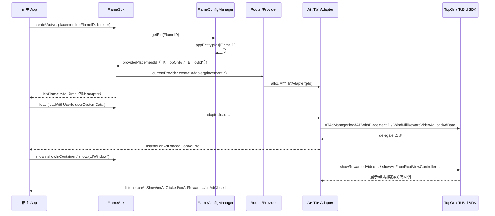

# 05 · 广告位与对外 API

> 代码证据：`flame_sdk_ios/flame_sdk_ios.h`（umbrella）、`flame_sdk_ios/ads/*/*.h`、`core/FlameSdk.m`、`core/FlameConfigManager.m`

## 1. Public Header Inventory（framework Headers 目录实有 10 个）

| 文件 | 公开类/协议 | 用途 |
|---|---|---|
| flame_sdk_ios.h | —（umbrella） | 统一入口；**注意缺 `#import <flame_sdk_ios/FlameNativeAd.h>`**（Native 头在 Headers 目录但未进 umbrella import 列表） |
| FlameSdk.h | `FlameSdk` | init / 状态 / 6 个广告工厂 |
| FlameCallback.h | `FlameCallback` | init 回调（success / fail:desc:） |
| FlameRewardAd.h | `FlameRewardAd` + `FlameRewardListener` | 激励视频 |
| FlameSplashAd.h | `FlameSplashAd` + `FlameSplashListener` | 开屏 |
| FlameInterstitialAd.h | `FlameInterstitialAd` + `FlameInterstitialListener` | 插屏 |
| FlameBannerAd.h | `FlameBannerAd` + `FlameBannerListener` + `FlameBannerRenderType` | 横幅（Express/SelfRender） |
| FlameBannerAdMaterial.h | `FlameBannerAdMaterial` | 自渲染横幅物料模型（title/desc/cta/iconUrl/coverUrl/advertiser/domain/warning/rating/sponsor/source/hasVideo/requires*——**无任何 ecpm/price 字段**） |
| FlameBannerAdRenderSlots.h | `FlameBannerAdRenderSlots` | 自渲染合规插槽（container/media/logo/adMark/close weak + clickableViews） |
| FlameNativeAd.h | `FlameNativeAd` + `FlameNativeListener` + `FlameNativeRenderType` | 原生（注意：Listener 方法**无 @optional 标注，全 @required**，与其它 Listener 不同） |

非 public（internal，不得混入）：FlameMediationProvider.h、Flame*AdapterProtocol.h、At*/Tb* 全部、FlameAppEntity/ConfigManager/Logger/ErrorCode/AdapterManager、utils/*。

## 2. 初始化 API 摘要

见 `02_SDK初始化与配置.md`。核心：`+initWithAppId:appKey:callback:` / `+clear` / `+isInitialized` / `+setDebug:` / `-getVersion`。

## 3. 广告位 create API（PLACEMENT_PUBLIC_API_SURFACE）

| 广告类型 | 创建方法（FlameSdk 类方法） | placementId 参数 | VC 参数 | Listener | 返回 |
|---|---|---|---|---|---|
| Reward | `+createRewardAdWithViewController:placementId:listener:` | NSString | 需要 | `id<FlameRewardListener>` | `id<FlameRewardAd>` |
| Splash | `+createSplashAdWithViewController:placementId:listener:` | NSString | 需要 | `id<FlameSplashListener>` | `id<FlameSplashAd>` |
| Interstitial | `+createInterstitialAdWithViewController:placementId:listener:` | NSString | 需要 | `id<FlameInterstitialListener>` | `id<FlameInterstitialAd>` |
| Banner Express | `+createBannerAdWithPlacementId:listener:` | NSString | **不需要**（load 时传） | `id<FlameBannerListener>` | `id<FlameBannerAd>` |
| Banner SelfRender | `+createSelfRenderBannerAdWithPlacementId:listener:` | NSString | 不需要 | 同上 | `id<FlameBannerAd>` |
| Native | `+createNativeAdWithViewController:placementId:listener:` | NSString | 需要 | `id<FlameNativeListener>` | `id<FlameNativeAd>` |

六者内部守卫序列一致（FlameSdk.m:463-832）：isInitialized → getPId 映射 → Router.currentProvider → provider.create*Adapter → 包成 *Impl。任一环失败：**同步回调 listener.onAdError + 返回 nil**。

## 4. placementId 真实语义（HOST_PLACEMENT_ID_SEMANTICS）

**= FLAME_PLATFORM_PLACEMENT_ID（Flame 平台广告位 ID）**

源码证明链：
1. 宿主把 Flame 广告位字符串传入 `create*(…placementId:)`
2. `FlameSdk` 调 `[FlameConfigManager getPId:placementId]`（FlameSdk.m:476 等）
3. getPId = `appEntity.pIds[flamePlacementId]`（FlameConfigManager.m:337-341）——查服务端下发的映射表
4. 映射出的 `pId` 传给 `provider.create*Adapter(placementId:pId)`（FlameSdk.m:505）
5. At*/Tb* Adapter 直接拿它调用 `ATAdManager`（TK）或 `WindMillAdRequest.placementId`（TB）

Demo 佐证：`adsurge-ios-demo/Sources/Ad/FlameAdConfig.swift` 的 `PlacementId` 枚举按 TK/TB 变体维护** Flame 侧**字符串常量，load 前只做非空检查。

## 5. pIds 映射语义

| 线 | pIds 的 key | pIds 的 value |
|---|---|---|
| pt=tk | Flame 广告位 ID | **TopOn/AnyThink 后台的广告位 ID**（供 ATAdManager loadADWithPlacementID） |
| pt=tb | 同一个 Flame 广告位 ID | **ToBid/WindMill 聚合位 ID**（供 WindMillAdRequest.placementId） |

服务端按 app 当前 pt 下发对应平台 value；同一 Flame key 在两条线值不同。pIds 持久化时被序列化为 `k=v&k=v` 串（**value 含 `=`/`&` 会解析丢失**，见 10_技术债务）。

## 6. 第三方广告位 ID 边界

**THIRD_PARTY_PLACEMENT_ID_EXPOSED = NO**。全部 10 个公共头中没有任何 API 要求客户传 AnyThink / WindMill / GroMore 广告位 ID；第三方 ID 只存在于服务端下发的 pIds value 与 adapter 内部。冻结现状。

## 7. Placement 映射链路（Mermaid 时序）



## 8. 广告对象协议差异（AD_OBJECT_PUBLIC_CONTRACT）

| 能力 | Reward | Splash | Interstitial | Banner | Native |
|---|---|---|---|---|---|
| load / loadWithUserId | ✅（无尺寸） | ✅（无尺寸） | ✅（无尺寸） | ✅ `loadWithWidth:height:viewController:` | ✅ `loadWithWidth:height:` |
| isReady / isLoading | ✅ / ✅ | ✅ / ✅ | ✅ / ✅ | ✅ / ✅ | ✅ / ✅ |
| show | `-show` | `-show:(UIWindow*)` | `-show` | `-(UIView*)retrieveAdView` | `-showInContainer:(UIView*)` |
| 渲染模式 | — | — | — | 创建期定 Express/SelfRender | `setRenderType:`（**非绑定 hint**，物料驱动自动降级） |
| 物料 API | — | — | — | `retrieveMaterials` / `bindMaterialAtIndex:slots:` / `unbindMaterial` | — |
| remove / destroy | destroy | destroy | destroy | remove + destroy | remove + destroy |

Listener 事件差异：Splash 特有 `onAdLoadTimeout`（TK 默认 5s tolerate）+ `onAdShowComplete:userId:userCustomData:` + `onAdReward:userId:userCustomData:`；Interstitial 特有 `onAdReward:(NSString*)placementId userId:… userCustomData:…`（**第一参数是 placementId**，与 Reward 的 transId 尾参不同）；Banner 特有 `onAdMaterialReady:(NSArray<FlameBannerAdMaterial*>*)`；Native 的 Listener 全 @required（其余全 @optional）。

## 9. load / show 使用模型（客户标准时序）

**分离式（无自动 load-on-show）**：

```
create*（拿到对象）
→ load / loadWithUserId:…
→ 等 listener.onAdLoaded
→ （可选）isReady 检查
→ show / show:(UIWindow*) / showInContainer: / retrieveAdView
→ …事件回调…
→ onAdClosed 后：destroy 或直接再 load（TB Reward 已支持 close→reload）
```

Demo 证据（RewardVideoAdManager.swift）：`whenSdkReady → load(withUserId:userCustomData:) → onLoaded(isAdReady=true) → show 前查 ad.isReady() → onClosed → 置 nil + 自动 load 下一条`；错误走 RetryScheduler（max 5）。

## 10. 线程语义

**NOT_ENFORCED**：create / load / show / destroy 全链路无主线程检查、无 dispatch 归一（源码无 `NSThread.isMainThread` 断言）。广告回调线程 = 三方 SDK delegate 线程直接转发。无任何文档线程要求（README 未约定）。Demo 实际全部主线程调用 + 回调侧自行 dispatch main 防御。

## 11. 错误语义（PLACEMENT_ERROR_CONTRACT）

| 场景 | 行为 | 错误码 |
|---|---|---|
| 未初始化调 create* | **同步** listener.onAdError + 返回 nil | 14000 |
| placementId 无映射（pIds 缺 key） | 同上 | 14004（desc: "Invalid placement ID: <id>"） |
| 无激活 Provider | 同上 | 14003 |
| load 失败（三方） | 异步 listener.onAdError，三方 error.code 原样字符串 | 三方码 |
| **未 ready 调 show** | **仅 FlameLogger 日志，不回调 listener、无错误码**（各类型 Impl 统一此模式；adapter 内 `AD_NOT_READY` 分支因 Impl 前置 isReady 检查实际不可达） | — |
| TB SelfRender Banner | 创建后回调 onAdError（兼容降级设计） | 14003 |
